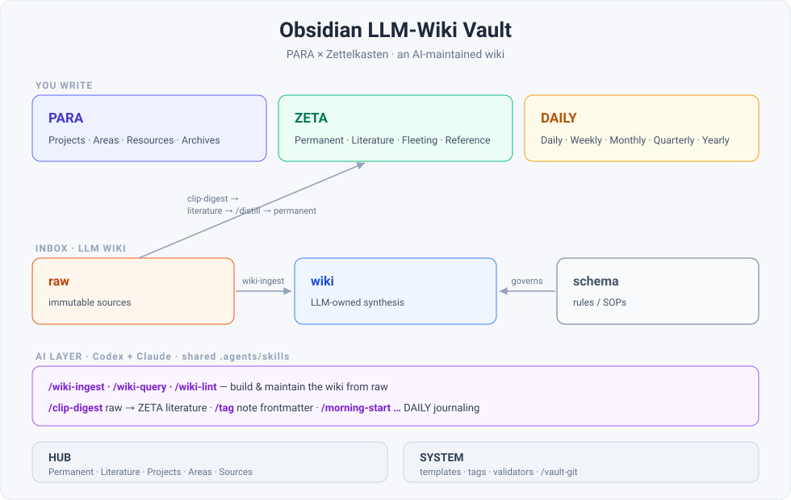

# Obsidian LLM-Wiki Vault

一个把 [PARA](https://fortelabs.com/blog/para/) 和[卡片盒笔记法](https://zh.wikipedia.org/wiki/卡片盒筆記法)跟一层 AI 结合起来的 Obsidian 库模板：一个由 [Claude Code](https://claude.com/claude-code) 帮着维护的 wiki，再加一组会自己保持更新的 [Datacore](https://github.com/blacksmithgu/datacore) 仪表盘。

[](LICENSE)  [English](README.md) · 中文



> 这是个模板，只有骨架——目录结构、各类笔记模板、仪表盘、标签系统，还有那套 AI 工作流，但里面没有任何个人笔记，也不含第三方内容。点 **Use this template**（或直接 clone），在 Obsidian 里打开，往里填自己的东西就行。

## 有什么不一样

市面上大多数所谓的「PARA 库」，说白了就是一套文件夹结构。这个库的不同，在于那层 AI——知识库不再只是堆在那儿，而是有个 LLM 帮你打理。

- **LLM Wiki**：一套 `raw → wiki → schema` 的机制，靠 Claude Code 的几个技能（`ingest` / `query` / `lint`）运转。你把资料丢进去，它读完写成一堆互相链接的 wiki 页，顺手帮你交叉引用、去重、保持前后一致。思路来自 [Karpathy 的「LLM Wiki」](https://gist.github.com/karpathy/442a6bf555914893e9891c11519de94f)。
- **标签系统**：每篇笔记三个 frontmatter 字段——`tags`（从受控词表里挑）、`keywords`（随手填）、`summary`（一句话摘要）。读一遍正文就一次写齐，而且只补空缺，不会覆盖你手写的内容。
- **Datacore 仪表盘**：主页、各种 MOC、每个领域和项目的页面，都是实时从笔记里查出来的，不用手动维护任何列表。
- **PARA × 卡片盒**：要做的事（PARA）和脑子里的想法（ZETA）分两摊放，各管各的。
- **笔记模板**：项目、领域、文献、永久、闪念、会议，再加日/周/月记，每种都有现成的。
- **笔记工具栏和页面任务**：每篇笔记顶部有一条按文件夹切换的工具栏；整篇笔记也能当成待办，统一在 Mail Box 里处理。见 [SYSTEM/DOCS/zh/interface.md](SYSTEM/DOCS/zh/interface.md)。

## 目录结构

```
PARA/      要做的事：项目 · 领域 · 资源 · 归档 · 速记
ZETA/      要琢磨的想法（卡片盒）：永久 · 文献 · 闪念 · 参考
INBOX/     LLM Wiki：raw（不可变的源）· wiki（LLM 维护）· schema（规则）
DAILY/     时间笔记：日 · 周 · 月 · 季 · 年
HUB/       导航：主页 · 内容地图 · MOC · 仪表盘
SYSTEM/    模板 · 标签系统 · 脚本 · 文档（English + 中文）
.claude/   Claude Code 技能（AI 层）
```

PARA 和 ZETA 为什么要分开，见 [SYSTEM/DOCS/zh/structure.md](SYSTEM/DOCS/zh/structure.md)。

## 那层 AI

两个子系统，都跑在 [Claude Code](https://claude.com/claude-code) 上：

| 系统 | 干什么 | 技能 | 规则（唯一真源） |
|---|---|---|---|
| **LLM Wiki** | 把 `INBOX/raw` 里的资料整理成 `INBOX/wiki` 里互相链接的综合页 | `/wiki-ingest` · `/wiki-query` · `/wiki-lint` | [INBOX/schema/wiki-schema.md](INBOX/schema/wiki-schema.md) |
| **标签系统** | 给笔记的 frontmatter 写 `tags` / `keywords` / `summary` | `/tag` | [SYSTEM/TAGS/tag-spec.md](SYSTEM/TAGS/tag-spec.md) |
| **剪藏消化** | 把网页剪藏整理成 `ZETA/LITERATURE` 里的文献笔记 | `/clip-digest` | — |
| **日志复盘** | 带着你做日 / 周 / 月笔记的规划和复盘 | `/morning-start` · `/daily-review` · `/weekly-start` · `/weekly-review` · `/monthly-start` · `/monthly-review` | — |

完整说明见 [SYSTEM/DOCS/zh/llm-wiki.md](SYSTEM/DOCS/zh/llm-wiki.md)。

## 上手

1. 点 **Use this template**（绿色按钮）或 `git clone`，然后在 Obsidian 里把这个文件夹当成库打开。
2. 弹窗问的时候**信任此库**——仪表盘要跑 Datacore 的 JSX。
3. **把仪表盘依赖的社区插件装上**（见[插件](#插件)）：配置都预设好了，只是插件本身没打包进来。
4. 打开 **`HUB/Homepage.md`**，这就是你的起点。
5. 想用 AI 的话（可选），在 Claude Code 里打开这个库，试试 `/wiki-ingest`、`/tag`、`/clip-digest`。

更细的设置见 [SYSTEM/DOCS/zh/getting-started.md](SYSTEM/DOCS/zh/getting-started.md)。

## 插件

核心依赖（配置已经在 `.obsidian/` 里，从社区插件市场装上即可）：

- **Datacore**（必需，所有仪表盘都靠它）、**Dataview**、**Templater**、**Meta Bind**、一个周期笔记插件（比如 **Journals**），外加几个用着顺手的小插件。完整清单在 `.obsidian/community-plugins.json`。

> `.obsidian/plugins/` 里的插件代码版权归各自作者、遵循各自的许可证；本仓库的 MIT 只覆盖原创的模板内容。

## 几点设计取舍

- **PARA 和 ZETA 分开。** 要做的事、技能归 PARA，想法、概念归 ZETA。平时只在各自系统里连链接，跨系统的链接是要刻意去建的。
- **为什么让 LLM 来维护 wiki。** 维护知识库最累的不是读、不是想，而是记账那摊活儿：更新交叉引用、把摘要改新、标出前后矛盾。这些事 LLM 几乎不花成本就干了，wiki 也就因此能一直保持新鲜。详见 [SYSTEM/DOCS/zh/llm-wiki.md](SYSTEM/DOCS/zh/llm-wiki.md)。
- **用仪表盘代替手写索引。** 笔记带上 `type` 和标签，Datacore 就能实时生成视图，省得自己维护列表。

## 致谢

- 最早是在 DuskWasHere 的 [dusk-obsidian-vault](https://github.com/DuskWasHere/dusk-obsidian-vault)（MIT）基础上改的，后来做了大量重构和扩展。
- LLM Wiki 这一层的思路来自 [Karpathy 的「LLM Wiki」](https://gist.github.com/karpathy/442a6bf555914893e9891c11519de94f)。

## 许可

[MIT](LICENSE)，覆盖原创的模板内容（结构、模板、脚本、文档）。第三方插件、主题、字体各自遵循自己的许可证。
